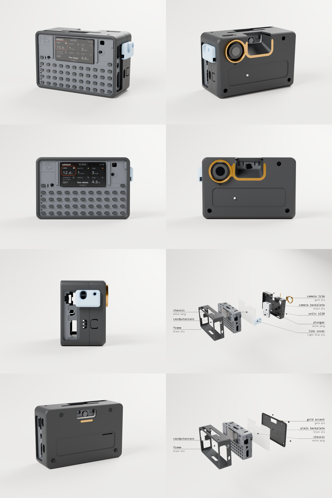

# Catalyst case for the CardputerZero: concept and measurements

> **Status: built.** The concept below was approved with these choices:
>
> - **Colours:** Night (black PLA body, gold trim, light-blue link cover, white PETG chassis).
> - **Battery:** none. The battery, charge board and light pipe were dropped.
> - **Backplates:** two interchangeable backplates on one frame and chassis, fixed with the CardputerZero's own M2 holes:
>   - the camera backplate (UnitV K210, Grove link);
>   - the plain backplate.
>
> The build is in `case.scad`, `stl/`, `renders/` and **`PRINTING.md`**, which covers parts, times, hardware, assembly and the fit test.
>
> Sections 4 (battery) and 6-8 (parts, hardware, printing) are the phase 1 proposal; `PRINTING.md` replaces them. Measurements, sources and the port map below still apply.

**The idea.** A soft, dark field camera that wraps the CardputerZero:

- **Frame.** A thin black frame holds the device by a lip and frames the keyboard and screen.
- **Camera backplate.** A 16.2 mm pod holds an M5Stack UnitV K210 beside the built-in IMX219, giving the dual-camera look. The pod's depth is set by the UnitV's 12.7 mm lens end.
- **Plain backplate.** A 3.4 mm back for everyday use.
- **Accents.** One gold signal part per backplate. A light-blue ("ice") link cover marks the Grove data link.
- **Ports.** Every port, control, key and the whole screen stays usable.

| Render | File |
| --- | --- |
| Camera backplate: front, back, side, three-quarters, exploded | `renders/camera-*.png` |
| Plain backplate: three-quarter, back, back three-quarter, side, exploded | `renders/plain-*.png` |

**Coordinates used throughout.**

- **X** runs left to right, seen from the screen, 0 to 84.
- **Y** runs from the keyboard edge (0) to the top edge with the EXT header (54).
- **Z** runs from the device back (0) to the front face (22.1). The back pod sits at negative Z.
- All values are in mm.

---

## 1. Measured dimensions and sources

| What | Value | Source |
| --- | --- | --- |
| Body | 84.0 × 54.0 × 23.1 mm, 95 g | [docs.m5stack.com/en/CardputerZero](https://docs.m5stack.com/en/CardputerZero) |
| Thickness detail | 22.1 body, 23.1 screen bezel (raised area X16.7-83, Y29.8-52), 23.2 overall | [model size PDF](https://m5stack-doc.oss-cn-shenzhen.aliyuncs.com/1243/C154_CardputerZero_model_size.pdf); STL sections |
| Plan corner radius | 3.0 | STL sections at 5 heights (`tools/measure_profile.py`) |
| Back fixings | 4× M2 at X14/28/56/70, Y50 (X28 and X56 blind, about 3.5 deep; X14 and X70 at the bottom of 4.4 mm slots). 4× Ø4.9 LEGO-pitch holes at X6/22/62/78. 2 through screws at (13, 30) and (70, 40) | Drawing plus STL |
| Every port and opening | See §2 | [M5 enclosure STL](https://github.com/m5stack/M5_Hardware/tree/master/Products/C154_CardputerZero/Structures), ray-cast with `tools/measure_openings.py` |
| Power path | See §4 | [Schematic V0.6.1](https://m5stack-doc.oss-cn-shenzhen.aliyuncs.com/1243/C154-CardputerZERO_SCH_V0.6.1_20260702.pdf), pages 1, 2 and 9 |
| UnitV-M12 | 40 × 24 × 16.4 mm, 13.4 g, 5 V @ 500 mA. Body 12.7 thick at the lens end (first 17 mm), 8.2 thick after. M12 holder 14 × 14, centred 12 mm in and 9 mm from the lens end. Two LEGO holes 28.2 mm from the lens end | [docs](https://docs.m5stack.com/en/unit/UnitV-M12), [STL](https://github.com/m5stack/M5_Hardware/tree/master/Products/U078-V-M12_UnitV-M12/Structures) |

M5 publishes STL files, not STEP or DXF, for both parts. `tools/prep_refs.py` downloads them and places them in the coordinates above.

## 2. Port map

The frame uses 2.0 mm walls with 0.25 mm clearance. Each window is the measured opening plus room for the plug's overmold:

- USB-C: 12.4 × 6.5
- USB-A: 16 × 8.5
- HDMI: 21 × 11
- RJ45: the boot plus thumb room for the latch

| Side | Part (measured opening) | Case handling |
| --- | --- | --- |
| Left | RJ45, Y5.0-21.2 Z2.2-16.8 | One stepped window (rounded R1.6) over the RJ45, the switch, the USB-A and USB-C1 |
| Left | USB host/device slide switch, Y24-31 Z13.4-20.2 | Same window, with fingertip room |
| Left | USB-A, Y33.4-46.6 Z8.8-16.0 | Same window |
| Left | USB-C1 (host output; shares 1 A with USB-A), Y35.6-44.4 Z17-20.2 | Same window |
| Right | HDMI type A, Y5.8-20.6 Z9.8-15.4 | One clean window, Y3-47.4 Z7-21.6, R2.5 |
| Right | 3.5 mm TRRS, Y25-30 Z11.4-16.8 | Same window |
| Right | Grove HY2.0-4P, Y34-46 Z10.6-17 | Same window. The link cover carries the K210 cable (§3) |
| Right | USB-C2 (charging input and OTG), Y35.5-44.5 Z17-20.2 | Same window. Fully open above the link cover |
| Right | Recessed control near the back, Y40.2-46 Z2-5.4 | Own capsule, plus a chamfered window through the link cover. **Purpose unconfirmed** |
| Right | 3 slots at the back-right corner, Y14-21 Z1-4.5 | Own capsule |
| Top | Slide switch, X8.6-14.4 Z17-20 (most likely the power switch: "slide right = on") | Top window, fingertip room |
| Top | microSD, X18.2-29.8 Z17-18.8 | Same window |
| Top | EXT 2×7 header, X32.8-51.2 Z10.4-16.8 | Same window, room for a female header or a HAT |
| Top | Narrow slot, X37.8-46 Z18.6-19.6 | Same window |
| Top | 2 × 4 vents, Z7.2-9.8 | Same window |
| Top | Pinhole, X75.4-76.6 Z17-19 (probably a microphone) | Own capsule |
| Bottom | Speaker grille (8 slots), X31.2-52.8 Z11.2-15.2 | Capsule, X29.6-54.4 Z10-16.4 |
| Front | Keyboard (46 keys), X2.2-81.8 Y2.2-30.8; screen window X20.8-63.2 Y28.6-51.2; 3 LEDs at X3; small slot X9 Y29.5 (likely microphone); window X69.4-73.6 Y47.2-50.8 | Lip overlaps the face by only 0.8 mm (limited by the raised screen bezel at X83), so every key, LED and window is clear. 0.8 mm chamfer for the thumbs. Lip sits 0.8 mm proud of the screen |
| Back | IMX219 at (42, 47.8), with 2 rounded windows beside it (X30-37 and X47-54, Y49-52; probably IR TX/RX) | Open-topped camera bay (§3) |
| Back | Slit X10.8-23.2 Y25 | Chassis keeps a matching slot and a 0.6 mm air gap |
| Inside | Status LEDs | Covered by the front lip only where it overlaps the face; none are covered |

## 3. Camera mount: UnitV K210 beside the IMX219

**Placement.**

- The UnitV lies flat behind the device, lens end up, at X58.8-82.8 and Y12-52. That is right of the IMX219 seen from the screen, and left of it seen from the camera side.
- Its lens sits at (70.8, 43.0), 29 mm from the IMX219.
- It locates on two Ø4.7 pins in the chassis, which go into its own LEGO holes, and the back shell holds it down.

**IMX219 field of view.**

- The pod is 16 mm deep, so a closed window would vignette the built-in camera. The case has a **camera bay** open to the top edge instead.
- It is sized for a standard IMX219 lens (62.2° × 48.8°) plus 3° of margin: X27-57 and down to Y36 at the surface. The walls slope to the chassis window.
- The bay also exposes both flanking windows, so IR still works if they are the IR parts.

**Dual-camera look.** The gold trim runs as a U around the bay and a raised ring around the K210 lens. It is the single signal accent.

**Physical limit on alignment.** The UnitV puts its lens 9 mm from its end, so its lens centre sits about 5 mm lower than the IMX219's. Perfect alignment needs a back that is about 4 mm taller than the frame. The bay and the ring are drawn so their visual centres line up.

**What stays reachable on the UnitV.**

| Feature | How you reach it |
| --- | --- |
| M12 lens | Ring ID 18 around a Ø14 barrel. Lift off the trim (snap pegs) and about 1.8 mm of barrel stands proud to unscrew. The trim uses no magnets, because the BMM150 compass sits inside the device |
| microSD (lens end) | Slot window in the pod's top face, X64.8-78.8 |
| USB-C (far end) | Tunnel to the pod's bottom face, X64.3-77.3 |
| Button A (right side) | Flexure key in the pod's right wall |
| Button B (inner side) | Pin key on the back (Ø2.2); a printed wedge plunger turns the press sideways |

**Grove link (as requested).**

- **Route.** A 10 cm M5 Grove cable runs from the UnitV's far end, behind its thin section, out through the pod's right wall, and into the light-blue **link cover**. The cover carries it up to the device's Grove port. The cover also has a window for the recessed control.
- **Unavoidable conflict.** On the CardputerZero itself, the Grove socket sits directly under USB-C2 (centres 4.6 mm apart). With a Grove plug fitted, only slim USB-C plugs (about 5.5 mm overmold or less) fit USB-C2. The cover stops below the plug so the case adds nothing to this.
- **Cleaner option.** The EXT header carries the same UART pins (G14 TX on pin 14, G15 RX on pin 12), plus 5VOUT on pin 6 and GND on pin 4. Wiring the K210 there hides the cable completely, removes the link cover, and frees both the Grove port and USB-C2. The cost: the HAT 5 V output needs the `PYG13_HAT_EN` switch turned on in software. See question 5.

## 4. Battery

**What is already inside** (schematic V0.6.1):

- **Cell:** 3.7 V 1750 mAh (6.5 Wh) with an NTC, behind a BQ27220 fuel gauge.
- **Charger:** an IP2315, fed by a TPS2116 that picks **USB-C2 first, then the EXT header's 5VIN pin**. Both inputs have their own OVP (AW32901).
- **System power:** the system runs from VSYS_IN. When either 5 V input is present, a P-FET (LP3218) disconnects the cell, and the 5 V feeds VSYS through a diode. An SY7088 boosts to 5 V.
- **Effect:** feeding a clean 5 V into **EXT pin 2 (5VIN) and pin 4 (GND)** makes the CardputerZero run from that supply and charge its own cell from it. The two cells are never in parallel.
- **Current use:** you measured about 2 W at idle and about 1 hour of full use.

**Options**

| | A. Slim LiPo and power-bank board (**recommended**) | B. 18650 sled | C. M5Stack Base Dual 16340 (A179) |
| --- | --- | --- | --- |
| Cell | One 1S LiPo, 10 × 30 × 50 class, about 1500 mAh (5.6 Wh), with its own protection board (PCM) | One protected 18650, 3000-3500 mAh (11-13 Wh) | 2 × 700 mAh 16340 in a factory parallel pair (DW01A protection) |
| Electronics | Charger, 5 V boost and protection board (≥2.5-3 A out, NTC input, USB-C input, about 24 × 21 mm) | Same board | Built in. Slide switch, INA226 monitor. 5 V output rating not published |
| Feeds | EXT pin 2/4 through a 2 A polyfuse | Same | Same, wired from its Grove/M-Bus 5 V |
| Case thickness | **40.1 mm** (42.5 at the lens ring) | About 47 mm (pod about 23) | About 50 mm (base is 54 × 54 × 21) |
| Added runtime | About +70% (about 4.5 Wh delivered) | About +150% | About +60% |
| Weight | +about 35 g | +about 60 g | +66 g |
| Notes | Fits beside the K210; best balance of size and runtime | Swappable cell, most energy; heavy and thick; watch for fake or unprotected cells | Off the shelf, least integrated, thickest |

**Recommendation: A.** It keeps the case at about 40 mm and fits beside the K210 without a bulge. It roughly doubles practical runtime, and it uses the input M5 designed for exactly this.

**How it charges.**

- **Pack:** charges through its own USB-C on the pod's left face, with its 4 LEDs shown through the ice light pipe.
- **CardputerZero:** still charges through USB-C2 as before.
- **Pack switch:** on the pod's left face, it disconnects the pack for storage.

**Safety (built in, not optional).**

- **Cells:** never parallel cells. The pack only ever supplies regulated 5 V to the device's own protected input. Protected cell only (PCM). The board cuts out on low voltage, and the cell's NTC is wired to the board.
- **Wiring:** a 2 A polyfuse in the 5 V lead. A keyed JST-PH connector so polarity cannot be reversed.
- **Battery bay:** PETG, with 0.6 mm air-gap ribs against the device back and 2.4 mm of swell room plus a foam pad. No screw points at the pouch.
- **Heat:** the board (about 1 W of heat at 2 A) sits in the top-left corner, away from the cell.
- **Charging limits:** charge only between 0 and 45 °C. Do not charge the pack in a hot car.
- **To measure first:** the CardputerZero's charging current at 5 V (USB meter, low battery, screen on). That sets the boost rating. If the board is too weak, the pack drops out under load instead of overheating, but it is still the wrong part.

## 5. Shape and style (Bezel)

- **Concentric corners.**
  - Device R3.0, cavity R3.25, frame R5.25 (= cavity + wall).
  - The lip opening is R2.2 (= 5.25 − 3.05 lip width).
  - The back shell's inner rear edge is its outer radius minus the 1.6 skin.
  - The capsule windows have radius = half their height.
- **Soft surfaces.** The rear edge radius tapers from 2.4 at the camera end to 5.0 at the grip end, so the top reads precise and the part in your palms reads soft.
- **Tonal step.** A 0.5 mm grip panel on the lower back, like a surface container.
- **Reveal line.** A 0.3 mm shadow line at the frame/back split.
- **One signal.** Gold (closest to Bezel's amber) appears only on the camera trim.
- **Ice.** Light blue marks "on/connected": the link cover and the pack light pipe.
- **One light.** The renders use a single key light above and to the left, as Bezel does.
- **Keyboard framing.** A thin 3.05 mm black lip with a thumb chamfer, nothing over the keys.

**Colour schemes** (four filaments: gold, light blue, white PETG, black)

| Part | **Night (recommended)** | Ice (alternative) |
| --- | --- | --- |
| Frame | black PLA | white PETG |
| Back shell | black PLA | light-blue PLA |
| Camera trim | gold PLA | gold PLA |
| Link cover / light pipe | light-blue PLA | white PETG |
| Chassis and battery bay (hidden) | white PETG | white PETG |

Night is closest to Bezel's dark tonal panels with one orange signal. Ice is Bezel's light tone: soft and friendly, with white and light blue as close tonal neighbours. The PETG goes where strength and heat matter: the chassis carries the inserts, the screws, the battery bay and the K210, and it sits against the warm device back.

## 6. Parts, split lines and assembly

| # | Part | Material | Size (mm) | Notes |
| --- | --- | --- | --- | --- |
| 1 | Frame | body colour | 88.5 × 58.5 × 25.5 | Front lip and side walls, open at the back. Split line at Z −1.6 |
| 2 | Chassis | white PETG | 84.3 × 54.3 plate | Screws to the device. Battery rails, K210 pins, board stand-offs, insert blocks, top hook catches |
| 3 | Back shell | body colour | 88.5 × 58.5 × 14.6 | Pod skin, camera bay well, trim pocket, every UnitV and pack opening |
| 4 | Camera trim | gold PLA | 57 × 21.6 × 3.2 | Inlay plus lens ring. Removable with snap pegs |
| 5 | Link cover | light blue | 14.8 × 24 × 5.2 | Right side; carries the Grove cable |
| 6 | Light pipe | light blue / white | 11.3 × 2.5 | Pressed into the back shell over the pack LEDs |

**Assembly.**

1. Chassis onto the device back: 2 × M2 into the device's X28/X56 holes, with dowels in the X14/X70 slots.
2. Device and chassis slide into the frame from the back.
3. Fit the K210 onto its pins, then the battery, the board and the Grove cable.
4. Hook the back shell over the top catches and close it.
5. Fit 2 × M2.5 screws up through the bottom face into the chassis inserts. No screws show on the back.
6. Clip the trim, the link cover and the light pipe on.

The frame is clamped between the device face and the back shell's rim.

## 7. Hardware

| Qty | Item |
| --- | --- |
| 2 | M2 × 5 pan-head screws (chassis to the device's own M2 holes) |
| 2 | Ø4 × 10 steel dowel pins (into the device's X14/X70 slots; so the chassis prints flat) |
| 2 | M2.5 × 8 countersunk screws and 2 × M2.5 brass heat-set inserts (OD 3.5-4, L 4) for the back shell |
| 1 | M2 × 6 screw and 1 × M2 heat-set insert for the link cover |
| 1 | M5Stack Grove cable, 10 cm |
| 1 | 1S LiPo about 1500 mAh, 10 × 30 × 50 class, with PCM and NTC lead, JST-PH 2-pin |
| 1 | 1S power-bank board (charge, 5 V ≥2.5-3 A boost, protection, NTC, USB-C, about 24 × 21 mm) |
| 1 | 2 A PTC polyfuse; 2-pin 2.54 mm lead for EXT pins 2/4 |
| 2 | Optional Ø8 × 2 silicone bumpons (desk feet) |
| 0 | Magnets: deliberately none, because of the BMM150 compass |

## 8. Printing

**Bed.** Your 256 × 256 mm bed takes every part. One plate per colour.

| Part | Orientation | Supports |
| --- | --- | --- |
| Frame | Lip face down, so the visible front gets the bed finish | None. Window tops print as bridges up to 43 mm. PLA handles that at bridge speed. For PETG, phase 2 gives the longest windows a 45° pointed top |
| Back shell | Outer back down | None. Phase 2 turns the first 1.5 mm of the bed-side edge radius into a 45° chamfer that blends into it, so it prints clean |
| Chassis | Device side down | None, because the dowels replace printed pins |
| Trim | Inlay face down, ring up | None. Use silk gold if you have it |
| Link cover | Seat face down | None |

**Settings.**

- **Layers:** 0.16-0.20 mm, 4 walls (about 1.6-1.8 mm), 25% gyroid.
- **Temperatures:** PLA at 210 °C, PETG at 235-240 °C.
- **Inserts:** 230 °C for PETG.
- **Fit check:** print a one-hour fit coupon first (the lip ring plus one side window) to tune the 0.25 mm clearance on your printer.

**Totals (estimate).**

- **Printed parts:** about 31 cm³, about 30 g.
- **Whole build:** about 175 g with the device, cell, board and K210. The device alone is 95 g.
- **Size:** 88.5 × 58.5 × 40.1 mm, plus the 2.4 mm lens ring and the 4.6 mm link cover.

## 9. Files

| Path | What |
| --- | --- |
| `case.scad` | Parametric OpenSCAD model. Every measured value is a named parameter, with its source in a comment |
| `tools/build.py` | Exports every part to `out/stl/` with the portable OpenSCAD in `.tools/`, Manifold backend, under 1 s per part |
| `tools/prep_refs.py` | Downloads M5's STLs into `_ref/` and places them in device coordinates |
| `tools/measure_openings.py`, `tools/measure_profile.py` | The ray-cast and section measurements behind §1 and §2 |
| `tools/render.py` | Blender Cycles renders: `blender -b -P tools/render.py -- night|ice VIEWS OUTDIR` |
| `tools/finish.py` | Backdrop, labels and overview sheet |
| `renders/` | The PNGs |

`.venv/`, `.tools/`, `_ref/` and `out/` are local and git-ignored.

## 10. Assumptions to confirm

- The right-side recessed control (Y40-46, near the back), the top slot X8.6-14.4 (taken as the power switch), and the two windows beside the IMX219 (taken as IR) are identified from geometry only. M5's docs give no locations for them.
- The IMX219 lens is taken to be the standard 62.2° × 48.8°.
- The UnitV's buttons and end-face connectors are read from its shells, with no part drawing.
