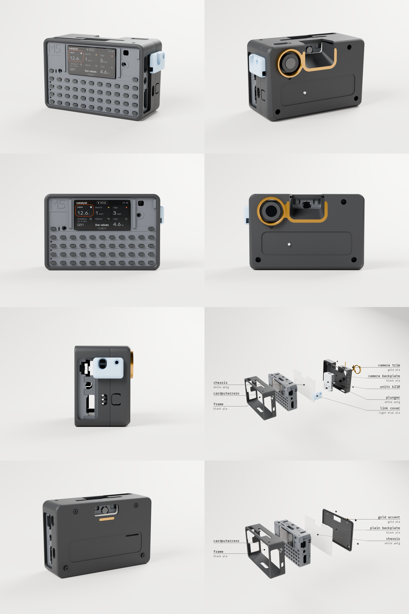

# Printing and assembling the Catalyst case

One **frame** and one **chassis** take either of two **backplates**. Swapping them takes a screwdriver and about two minutes.

| | Camera backplate | Plain backplate |
| --- | --- | --- |
| What it adds | UnitV K210 pod, gold camera trim, light-blue Grove link cover | Slim protective back, camera/IR window, small gold accent |
| Thickness | **40.1 mm** (42.5 at the gold lens ring) | **27.3 mm** |
| Footprint | 88.5 × 58.5 mm (93.1 wide with the link cover) | 88.5 × 58.5 mm |
| Printed parts | 39.5 g, 1 h 24 min | 32.0 g, 59 min |
| Total weight with the CardputerZero (95 g) | about 152 g (adds the UnitV, cable and screws) | about 128 g |

Renders are in `renders/`: `camera-*.png`, `plain-*.png` and `overview.png`.

## 1. Parts

All STLs in `stl/` are already oriented for the bed. Each file is named `part__material-colour`.

**Profile:** 0.4 mm nozzle; PLA at 210-215 °C with the bed at 60 °C; PETG at 235-240 °C with the bed at 80 °C. Seam at the rear. **No supports anywhere.**

**Estimates:** sliced with PrusaSlicer 2.9.2 (`tools/estimate.py`) using a fast CoreXY profile (Bambu P1/X1 class). A bed-slinger at stock speeds takes about twice as long.

| Part | File | Material | On the bed | Layer | Walls | Infill | Time | Filament |
| --- | --- | --- | --- | --- | --- | --- | --- | --- |
| Frame (both) | `frame__black-PLA.stl` | black PLA | front lip face down (best finish where you look) | 0.20 | 4 | 20% gyroid | 24 min | 12.8 g |
| Chassis (both) | `chassis__white-PETG.stl` | white PETG | device side down | 0.20 | 4 | 40% gyroid | 15 min | 8.3 g |
| Camera backplate | `back-camera__black-PLA.stl` | black PLA | back face down | 0.20 | 4 | 20% gyroid | 36 min | 16.6 g |
| Camera trim | `trim-camera__gold-PLA.stl` | gold PLA (silk is fine) | flat side down, ring up | 0.12 | 3 | 100% | 3 min | 0.6 g |
| Link cover | `link-cover-camera__light-blue-PLA.stl` | light-blue PLA | flat inner face down | 0.16 | 4 | 30% | 4.5 min | 1.1 g |
| Button-B plunger | `plunger-camera__white-PETG.stl` | white PETG | flat side down | 0.12 | 4 | 100% | 1.5 min | 0.1 g |
| Plain backplate | `back-plain__black-PLA.stl` | black PLA | back face down | 0.20 | 4 | 20% gyroid | 19 min | 10.9 g |
| Gold accent | `accent-plain__gold-PLA.stl` | gold PLA | flat | 0.12 | 3 | 100% | 1 min | 0.03 g |
| **Fit test** | `fit-test__black-PLA.stl` | black PLA (any) | as placed | 0.20 | 3 | 15% | **19 min** | 8.9 g |

**Total for everything** (fit test, frame, chassis, both backplates and all small parts): **about 2 h 2 min and 59 g.**

**Plates by colour:**

- **Black PLA:** frame, the backplate(s) and the fit test all fit together on a 256 × 256 bed.
- **Gold:** trim and accent together.
- **Light blue:** link cover.
- **White PETG:** chassis and plunger.

**Notes:**

- The frame's side windows print as bridges up to 43 mm long. Keep the bridge fan on at about 40 mm/s, as the profile does.
- The rear edges of both backplates start with a 45° chamfer that blends into the radius, so the bed-side edge does not droop.
- Print the chassis in PETG. It carries the screws and nuts and sits against the warm back of the device.

## 2. Hardware

**Shared parts (frame and chassis; stay in place when you swap backplates)**

| Qty | Part | Goes |
| --- | --- | --- |
| 2 | M2 × 4 countersunk (ISO 7046 / 10642) | Chassis into the device's blind M2 holes at X28/X56 (flush) |
| 2 | M2 hex nut (ISO 4032, 4 mm across flats, 1.6 mm thick) | Captive in the chassis, at the bottom corners |

**Camera backplate**

| Qty | Part | Goes |
| --- | --- | --- |
| 1 | **M2 × 25** socket head (ISO 4762) | Through the pod into the device's X14 slot hole |
| 2 | **M2 × 6** button head (ISO 7380) | Into the chassis nuts, bottom corners |
| 1 | M2 × 6 self-tapping screw for plastic (pan head) | Link cover into its rib |
| 1 | M5Stack Grove (HY2.0-4P) cable, 10 cm | UnitV to the device's Grove port |
| 2 | 6 × 6 mm thin double-sided tape (about 0.1-0.2 mm) | Under the gold trim, so it can be lifted for a lens swap |

**Plain backplate**

| Qty | Part | Goes |
| --- | --- | --- |
| 2 | **M2 × 16** button head (ISO 7380) | Into the device's X14 and X70 slot holes (about 2 mm of thread) |
| 2 | **M2 × 3** countersunk (ISO 7046) | Into the chassis nuts, bottom corners |
| 1 | A drop of glue or a scrap of tape | Under the gold accent |

**About the CardputerZero's screws.**

- **Holes used.** The case uses only the device's **four M2 mounting holes on the top strip of its back**:
  - two blind holes at X28 and X56, about 3.5 mm deep;
  - two at the floor of the 11.7 mm slots at X14 and X70.
- **Holes not used.** M5's own **shell screws**, the two through screws at (13, 30) and (70, 40), hold the CardputerZero together. The case never touches them.
- **Why the camera backplate reaches only X14.** The UnitV sits over X70, and the camera bay's walls sit over X28 and X56. That backplate therefore uses X14 plus the two chassis nuts, while the chassis's own screws hold X28 and X56.

Every hole position and screw length is a named parameter at the top of `case.scad`:

- **Hole positions:** `m2_blind`, `m2_pocket`, `nut_pos`, `hole_shift`.
- **Screw lengths:** `L_chassis`, `L_pocket_plain`, `L_pocket_camera`, `L_nut_plain`, `L_nut_camera`.

The counterbores and seats follow the lengths automatically, and OpenSCAD reports the resulting thread engagement when you export.

## 3. Assembly

**Both versions: frame and chassis**

1. Press the two M2 nuts into the hex pockets on the chassis's flat side, the side that faces the device. A touch of a soldering iron seats them.
2. Lay the chassis on the device's back, flat side down, with the camera opening over the IMX219. Fit the two M2 × 4 countersunk screws at X28/X56. Snug them, don't force them.
3. Slide the device and chassis into the frame from the back until the front lip sits on the face.

**Camera backplate**

1. Plug the Grove cable into the UnitV. Lay the UnitV on the chassis with its lens end at the top and its long side against the right wall's lane.
2. Run the cable out of the UnitV's far end, turn it right, and run it up the 3.8 mm lane along the right wall. Lay it flat, below the button-A key.
3. Drop the plunger into its guide in the backplate, pin first through the small hole.
4. Thread the cable end out through the slot in the backplate's right wall. Lower the backplate so the UnitV's LEGO holes land on the two pins. Press around the rim until the lip clicks into the frame.
5. Fit the M2 × 25 into the top bore at X14 and the two M2 × 6 at the bottom corners.
6. Lay the cable in the link cover's channel and plug it into the Grove port. Screw the cover on with the M2 × 6 self-tapping screw.
7. Stick two small squares of thin tape in the trim pocket and press the gold trim in.
   - To change the M12 lens, lift the trim at the notch under the ring. About 1.8 mm of barrel then stands proud to unscrew.

**Plain backplate**

1. Set the plain backplate on and press until the lip clicks in.
2. Fit the two M2 × 16 at the top corners (X14/X70) and the two M2 × 3 countersunk at the bottom corners.
3. Glue or tape the gold accent into its pocket under the window.

**Swapping backplates.** Remove that backplate's screws (camera: 3, plain: 4), lift it at the bottom edge, and fit the other one. The frame, chassis and their two screws stay put.

**USB-C2 note.** The CardputerZero's Grove socket sits right under USB-C2. With the Grove cable plugged in, USB-C2 takes only slim plugs (overmold about 5.5 mm thick or less). The link cover stops below the plug, so the case adds nothing to this.

## 4. What is measured and what is estimated

- **Measured from M5's model.** The device outline, all ports, the screen and keys, the four M2 holes and the UnitV come from M5's published STLs. Sources are in `CONCEPT.md`.
- **Estimated.** These have named parameters in section 2 of `case.scad`, with generous clearance:

| Parameter | Estimate | What it covers |
| --- | --- | --- |
| `key_top` | 23.2 | Keycap height |
| `imx_fov` | 62.2° × 48.8° plus `fov_margin` 3° | IMX219 field of view |
| `ir_win`, `ir_shave` | 30-54 mm, minus 0.8 at each outer edge | The two windows beside the camera, taken as IR |
| `side_ctrl` | Y40.2-46, Z2-5.4 | The recessed control on the right side |
| `pwr_slide` | X8.6-14.4 | Top slot, taken as the power slide |
| `m2_engage` | 3.0 | Thread depth in the slot holes |
| `ctrl_room` | 1.2 mm | Extra room around unconfirmed controls |

- **Plunger.** The button-B plunger's wedge is a best guess. If the button doesn't click, sand the wedge or adjust the `plunger` module by 0.2 mm.

## 5. Fit test (do this first, about 19 min)

`fit-test__black-PLA.stl` prints four pieces on one plate:

| Piece | How to use it | Parameters it checks |
| --- | --- | --- |
| **Front ring** (the frame's front 6 mm) | Press the CardputerZero in from the back. It should go in with light pressure and not rattle. The lip should sit flat on the face, clear of every key and of the raised screen bezel at the right edge. Nothing should bind at the corners. | `gap`, `lip_over`, `dev_r`, `key_top`, `dev_w`/`dev_h` |
| **Left and right side strips** (full-height walls with the port windows) | Hook the strip's lip over the device's front edge. Its rear end should stand 1.6 mm past the device's back, where the chassis goes. Then plug in every cable: USB-C1, USB-A, RJ45 (press the latch), HDMI, TRRS, Grove and USB-C2. Reach the USB switch, the power slide and the side control. | `port_room`, `ctrl_room`, `dev_t`, the window positions |
| **M2 hole strip** (backplate hole pattern) | Hook it over the device's top edge, flat on the back. Push an M2 screw through each of the four holes into the device: X14 and X70 go down the slots, X28 and X56 straight in. The camera and both IR windows must show fully through the opening. | `m2_blind`, `m2_pocket`, `hole_shift`, `ir_win`, `ir_shave`, `imx_fov` |

**Adjusting.** Edit the parameter at the top of `case.scad`, then run `python tools/build.py print`. Or open `case.scad` in OpenSCAD, set `part` (for example `"fit_print"`), press F6 and export the STL.

| Symptom | Change |
| --- | --- |
| Device too tight in the ring | `gap` += 0.05 to 0.1 |
| Device rattles | `gap` -= 0.05 |
| Lip rubs keys or the screen bezel | `lip_over` -= 0.2 |
| Lip too thin to hold | `lip_over` += 0.2 |
| Corners bind but sides are fine | `dev_r` += 0.2 |
| A plug's overmold rubs a window edge | `port_room` += 0.2 (grows every window). For one port, edit that rectangle in `left_windows()`, `right_windows()` or `top_windows()` |
| Side control or power slide hard to reach | `ctrl_room` += 0.5 |
| All four screws miss by the same amount | `hole_shift` = [dx, dy] (in mm, + is toward the right / top seen from the screen) |
| One screw misses | Edit its entry in `m2_blind` / `m2_pocket` |
| IR window edge covered | `ir_shave` -= 0.4 (the screw heads beside it then sit closer) |
| Backplate clicks in too hard / too loose | `snap` -= / += 0.1 |

Then print the full parts. Reprint the fit test only if you changed `gap` or `dev_*`.

## 6. Files

| Path | What |
| --- | --- |
| `case.scad` | Parametric model. Every part, the fit test and print orientations (`*_print`) |
| `stl/` | Print-ready STLs (this guide) |
| `renders/` | Final renders, both backplates |
| `tools/build.py` | Exports every STL with the portable OpenSCAD (`render`, `print` or `all`) |
| `tools/estimate.py` | Slices `stl/` with PrusaSlicer and prints time and filament |
| `tools/render.py`, `tools/finish.py` | Blender renders and the overview |
| `CONCEPT.md` | Measurements, sources and design rationale |
